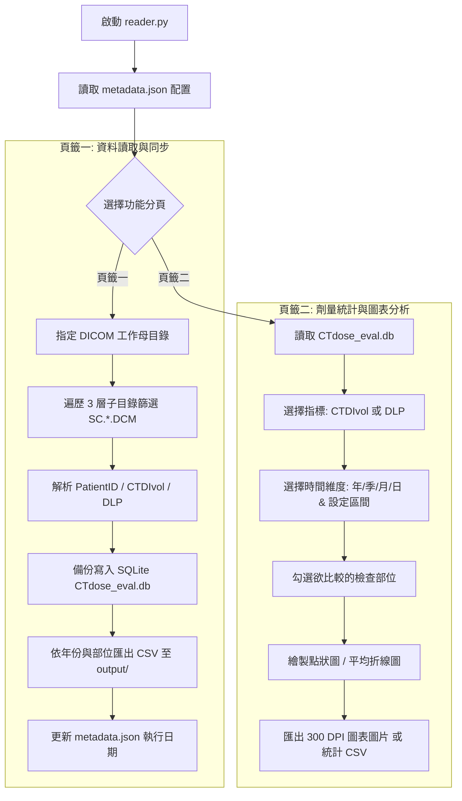

# CT Dose 輻射劑量自動化評估與統計系統 (CTdose Evaluation System)

針對放射治療（Radiation Oncology）或放射診斷部門 **GE CT Simulator** 之 Secondary Capture 劑量螢幕截圖（`SCREEN SAVE`）設計的自動化收集、劑量指標擷取、去重儲存、趨勢分析與報表匯出系統。

---

## 📌 版本特點 (Version 2.0)

* **🖥️ 現代化 GUI 視窗介面**：使用 Tkinter 打造直覺式雙頁籤操作介面（資料讀取與同步 / 劑量統計與圖表分析），支援多執行緒處理，執行時介面流暢不卡頓。
* **🔍 三層深度遍歷與標靶篩選**：自動遍歷 DICOM 母目錄下各子目錄（預設最多 3 層），精準鎖定主檔名以 `SC.` 開頭且副檔名為 `.DCM` 之劑量報告，大幅縮短掃描時間並降低 I/O 負載。
* **💾 資料庫去重與歷史保存**：內建 SQLite (`CTdose_eval.db`) 持久化資料庫，以 `study_ID` 為唯一鍵（Unique Index），重複讀取自動略過，確保資料完整不重複。
* **📊 互動式圖表與多維度統計分析**：
  * **點狀圖 (Scatter Plot)**：個別案例劑量標示，清楚呈現離群值與劑量分佈範圍。
  * **折線圖 (Line Chart)**：時間重複之個案依據週期自動計算平均值，繪製長期趨勢折線。
  * **四種時間維度**：年（Year）、季（Quarter）、月（Month）、日（Day）。
  * **時間區間選擇器**：支援自選起始與結束週期，並內建純 Python 原生彈出式月曆（`📅`）方便精準選日。
  * **檢查部位篩選**：自動由資料庫撈取所有檢查部位（如 `RTO CT H&N`、`RTO CT Chest`、`RTO 4DCT` 等），支援全選、全取消與個別勾選。
* **📤 雙軌報表與高解析度圖表匯出**：
  * 支援將圖表匯出為 300 DPI 高畫質圖片（PNG / PDF / JPG）。
  * 支援將統計彙總數據或個案明細匯出為 UTF-8-BOM CSV 報表。
  * 自動依年份與部位拆分儲存至 `output/{年份}_{部位}.csv`。
* **⚙️ 跨平台與 Windows .exe 自動編譯**：
  * 內建 GitHub Actions CI/CD，推送到 GitHub 即自動由雲端 Windows 伺服器編譯產出免安裝的 `CTDose.exe`。
  * 附帶 Windows 本機一鍵打包腳本 `build_exe.bat`。

---

## 🏗️ 系統架構與流程



---

## 📂 專案檔案結構

```text
CTdose_eval/
├── .github/workflows/
│   └── build_exe.yml       # GitHub Actions 雲端自動打包 Windows .exe
├── build_exe.bat           # Windows 本機一鍵打包批次檔
├── environment.yml         # Conda 虛擬環境建立檔
├── metadata.json           # 工作母目錄與忽略年份設定檔
├── reader.py               # 系統核心 GUI 與 DICOM 解析程式
├── reader.spec             # PyInstaller 打包規格設定檔
├── requirements.txt        # Python 相依套件清單
├── .gitignore              # 隱私過濾 (排除病患 DICOM、.db 與臨時檔)
└── README.md               # 專案說明文件
```

---

## 🚀 快速上手 (Quick Start)

### 1. 環境需求
* **Python**：3.9 ~ 3.12
* **主要套件**：`pydicom`、`pandas`、`matplotlib`

### 2. 安裝與執行

#### 使用標準 Python (pip)：
```bash
# 1. 複製專案
git clone https://github.com/Tonyfc52/CTdose_eval.git
cd CTdose_eval

# 2. 安裝套件
pip install -r requirements.txt

### 3. 使用方式 (GUI 介面 與 CLI 命令列模式)

#### 模式一：GUI 圖形介面（預設）
直接執行（或在 Windows 雙擊 `CTDose.exe`）：
```bash
python reader.py
# 或在 Windows 執行:
CTDose.exe
```

#### 模式二：CLI 命令列自動更新模式（不開視窗、不輸出 CSV）
適合設定於 Windows 工作排程器（Task Scheduler）定時自動排程執行：
```bash
python reader.py --update
# 或在 Windows 執行:
CTDose.exe --update
```
* **行為**：直接讀取 `metadata.json` 設定的母目錄，掃描 `SC.*.DCM` 報告，自動解析並備份至 `CTdose_eval.db`，完成後更新最後讀取日期並自動結束。不產生 `output/` CSV 報表。

---

## 📦 打包成 Windows 獨立執行檔 (.exe)

本系統支援兩種打包方式，打包後產出的 `CTDose.exe` 即使在**未安裝 Python 的 Windows 電腦**上亦可直接執行：

### 方式 A：GitHub Actions 雲端自動打包（推薦）
1. 將更新推送到此 GitHub 儲存庫。
2. 進入 GitHub 頁面的 **Actions** 頁籤。
3. 點選 **Build Windows Executable** 工作流程。
4. 編譯完成後（約 1~2 分鐘），至下方 **Artifacts** 區塊下載 `CTDose_Windows_Exe.zip` 即可取得 `CTDose.exe`！

### 方式 B：Windows 本機打包
在任何有安裝 Python 的 Windows 電腦上：
1. 下載本專案資料夾。
2. 直接雙擊滑鼠執行 `build_exe.bat`。
3. 程式將自動完成套件檢查與封裝，成果位於 `dist\CTDose.exe`。

---

## 🔒 隱私與資安提醒

* 本專案已配置完整的 `.gitignore`，自動排除 `*.dcm`、`*.db` 與測試輸出檔案。
* 請勿將包含病患個資（PHI）的真實 DICOM 檔案或正式臨床資料庫直接上傳至公開版本庫。

---

## 📜 授權與維護
* 核心維護：Tonyfc52
* 適用設備：GE Healthcare CT Simulator (Radiation Oncology / Secondary Capture format)
